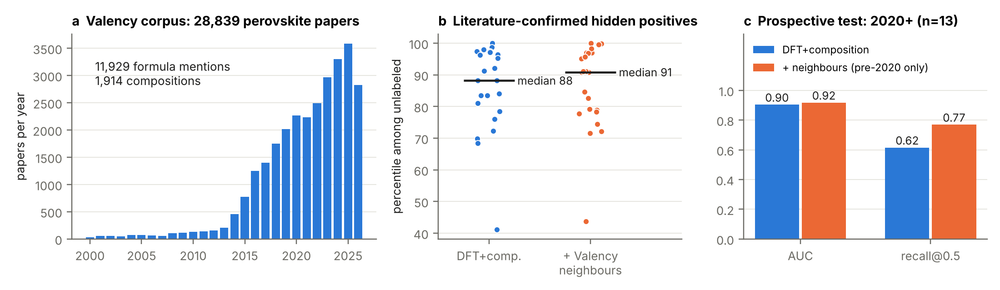

**Team:** Rushik Desai · **Code:** <https://github.com/rushikd27/valency-synth> · **Platforms:** Valency, Claude Code

**Problem.** DFT proposes thousands of halide and chalcogenide perovskites, but only a small fraction are ever made, and the ones that are come with no instructions. Our earlier positive–unlabeled (PU) model ([Desai et al., arXiv:2510.06166](https://arxiv.org/abs/2510.06166)) learns synthesizability from 1,228 compositions/polymorphs (251 synthesized) with DFT decomposition energy and band gap. Two questions remained: *can we check it against the literature without relying on our own labels*, and *once a candidate scores high, how would you make it?*

**What we built in two days.**

1. **Literature corpus from Valency.** We harvested every paper with "perovskite" in the title across PubMed, arXiv and ChemRxiv (238 date windows, ≤200 hits each): **28,839 abstracts** with first-availability dates. A formula parser extracts **11,929 mentions of 1,914 non-oxide compositions** and tags each as synthesis vs. theory context.
2. **Bagged PU model** (Mordelet & Vert) on composition descriptors (Goldschmidt/octahedral/Bartel τ, radii, electronegativity), crystal structure and DFT stability, evaluated by hidden-positive CV grouped by composition.
3. **Valency feature layers:** (i) mat2vec-style word2vec on the corpus with compositions embedded as fraction-weighted species vectors (works for never-mentioned formulas); (ii) similarity to the nearest *literature-synthesized* composition outside the dataset. Mention counts are **never** used as inputs to avoid label leakage.
4. **Route retrieval:** for each top candidate, synthesis-context abstracts mentioning it (direct) or its nearest synthesized neighbours (analogy), tagged by route (hot-injection, LARP, antisolvent, solvothermal, solid-state, vapour, melt, sulfurization…) with paper links.

**Results.** *Label-independent validation:* 23 compositions are unlabeled in our dataset yet reported as synthesized in the corpus (e.g. Cs₂AgSbCl₆, Cs₂SnBr₆, Cs₂TiBr₆, MASnBr₃). They were never shown as positives, yet the model ranks them at the **88th percentile** of unlabeled compositions (91st with the neighbour layer; panel b). *Prospective test:* rebuilding the Valency layers from pre-2020 abstracts only, compounds first reported in 2020 or later are recovered at recall 0.77 vs 0.62 without the layer, AUC 0.92 vs 0.90 (n = 13; panel c). Hidden-positive CV stays at recall 0.85–0.87, PU-AUC ≈ 0.91. The word2vec layer did **not** help (honest negative result: element-level co-occurrence is too coarse). The corpus also exposed **label noise**: Cs₂AgBiBr₆ (154 papers) and Cs₂SnI₆ are marked theoretical in every polymorph.

**Candidates with routes** (`results/candidate_routes.md`): e.g. Cs₂AgGaCl₆ and Cs₂AgAlCl₆ (score 0.95/0.93; analogy to Cs₂AgIn/BiCl₆: room-temperature precipitation, hot-injection), Cs₂CuBiCl₆ (direct: solution crystal growth), Cs₂ScAgBr₆ (antisolvent / LARP analogues).

**Impact and next steps.** The loop *literature → labels check → features → candidates → recipes* turns a static synthesizability score into a ranked, referenced to-do list for a synthesis lab, and keeps updating as Valency ingests new papers. Next: promote literature-confirmed compounds to positives, pull full experimental sections (Scite full text covered 23% in a pilot) into structured recipes, and extend to oxides.
